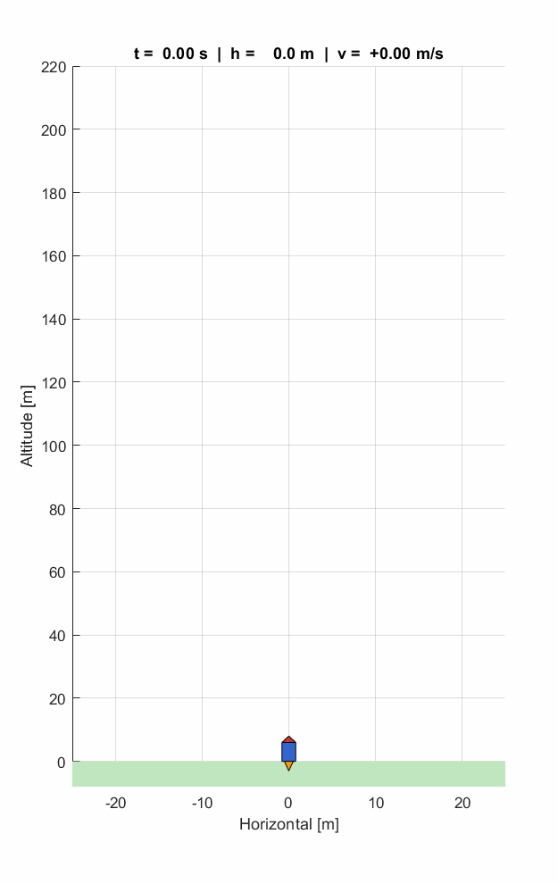
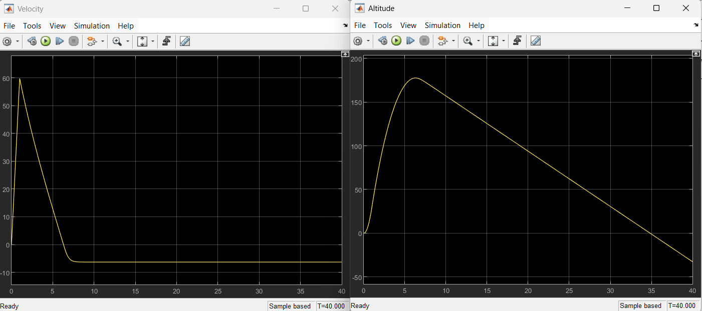
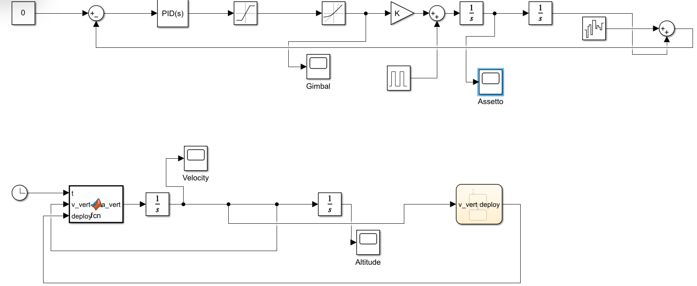
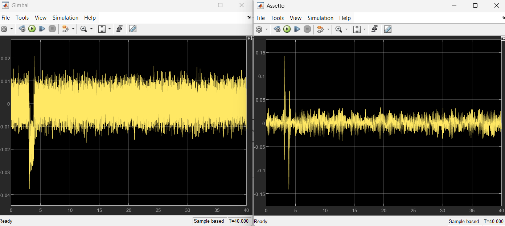

[README.md](https://github.com/user-attachments/files/34992171/README.md)

# Multi-Phase Rocket Flight Simulation

Full-mission simulation of a high-power model rocket — powered ascent, coast, automatic apogee detection and parachute descent — combined with a thrust vector control (TVC) attitude loop. Rocket parameters are derived from an OpenRocket flight simulation; the vertical dynamics are integrated in MATLAB and reproduced in a Simulink model that adds a Stateflow flight-phase state machine and a PID attitude controller.



## Pipeline

```
OpenRocket            →   MATLAB                →   Simulink
(mass, inertia,           (multi-phase flight       (vertical dynamics + Stateflow
 thrust, drag)             simulation + animation)    apogee detection + TVC loop)
```

## Rocket


Fiberglass airframe (~1 m), modelled in OpenRocket.

| Parameter | Value |
|---|---|
| Motor | AeroTech F62T-6 |
| Total impulse | 58 N·s (class F) |
| Burn time | 0.99 s |
| Liftoff mass | 792 g |
| Parachute | 70 cm diameter |
| Predicted apogee | 191 m |

## Part 1 — MATLAB multi-phase simulation

The flight is split into three phases, each integrated with `ode45`. Phase transitions are handled by event functions — the same logic a real flight computer uses:

1. **Powered ascent** — thrust, gravity and aerodynamic drag; mass decreases during the burn.
2. **Coast** — thrust off, decelerating under gravity and drag. Event: vertical velocity crosses zero → apogee detected → parachute deploy.
3. **Descent** — drag dominated by the parachute. Event: altitude reaches zero → touchdown.

The full flight is rendered as a 2D animation (exported as the GIF above).

| Quantity | OpenRocket | MATLAB sim |
|---|---|---|
| Apogee | 191 m | 177 m |
| Touchdown velocity | 6.31 m/s | 6.32 m/s |

A simplified constant-drag model matches OpenRocket within ~7% on apogee and is essentially exact on touchdown velocity.



## Part 2 — Simulink model (GNC + plant)

The Simulink model closes the loop around the same vehicle dynamics and adds the flight software.



**Flight-phase state machine (Stateflow).** An apogee-detection state machine switches from ASCENT to DESCENT at vertical-velocity zero-crossing and commands parachute deployment autonomously — independent of the motor's pyrotechnic delay.


**TVC attitude loop.** A PID controller with filtered derivative stabilises the pitch attitude, with realistic actuator limits (±5° gimbal saturation, 500°/s rate limit) and MEMS-grade IMU noise. A wind gust is injected as a disturbance: the controller rejects an 8° peak deviation and returns the rocket to zero within a few hundred milliseconds.



## Repository structure

```
rocket-multiphase-flight-simulation/
├── matlab/
│   ├── rocket_multiphase.m   # 3-phase simulation + 2D animation / GIF export
│   └── init_multiphase.m     # parameter script for the Simulink model
├── simulink/
│   └── rocket_multiphase.slx # closed-loop model: vertical dynamics + Stateflow + TVC
├── openrocket/
│   ├── razzo2.ork            # OpenRocket airframe model
│   └── razzo2_dati.csv       # exported flight data
└── results/                  # animation and plots
```

## Tools

MATLAB · Simulink · Stateflow · ode45 · OpenRocket 24.12

## Author

Francesco Pighetti — Aerospace Engineering student, Politecnico di Torino
